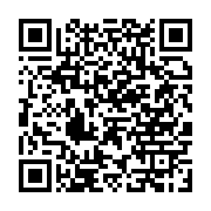

[English](README.md) | [繁體中文](README.zh-TW.md) | **日本語**

# n3ds cast

New 3DS の映像とゲーム音声を、Google Cast でテレビへ、または PC のブラウザへストリーミングします。本体が表示している内容をそのままキャプチャし、本体上で JPEG にエンコードして、受信側ページへ送ります。

**Luma3DS が動作する New 3DS / New 2DS XL** が必要です。ゲームには何も注入しません。フックもプラグインも使いません。

## インストールと使い方

最新リリースの `.cia` を FBI でインストールします。FBI で *Remote Install* > *Scan QR code* を選び、下の QR コードを読み取ります。ファイルを SD カードにコピーしても構いません。（`.3dsx` は代わりに Homebrew Launcher から実行できます。）



<https://github.com/weiking1021/n3ds-cast/releases/latest/download/n3ds-cast.cia>

その後:

1. アプリを起動します。テレビの一覧が表示されます（LAN 上の Cast デバイスと、PC 受信側が動いていればそれも）。
2. テレビを選んでストリーミングを開始し、HOME に戻ってゲームを起動します。キャプチャされるのは*ゲーム*で、このアプリではありません。
3. 終了してもう一度アプリを起動すると、動作中のバックグラウンドプロセスに再接続します。

NDS ゲームを起動するとストリームは終了します。

## PC 受信側

ブラウザのタブでテレビの代わりにできます:

```
cd receiver
npm install            # 最初に一度だけ
npm start              # http://localhost:8080 を開く
```

先にタブを開き、次に 3DS のテレビ一覧で **PC Receiver (dev)** を選び（または PC の IP を入力し）、ストリーミングを開始します。音を出すには、タブで「音声を有効にする」をクリックします。

## ビルド

必要なのは Docker だけです:

```
./build.sh                # out/n3ds-cast.cia と out/n3ds-cast.3dsx（Windows では build.bat）
```

## サードパーティ

UI フォント: Noto Sans TC Regular、SIL Open Font License 1.1（`3ds/app/assets/OFL.txt`、`COPYRIGHT.txt`）。
