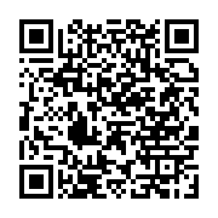

**English** | [繁體中文](README.zh-TW.md) | [日本語](README.ja.md)

# n3ds cast

Streams a New 3DS (video and game audio) to a TV through Google Cast, or to a browser on a PC. It captures whatever
the console shows, JPEG-encodes it on the console and sends it to a receiver page.

Requires a **New 3DS / New 2DS XL running Luma3DS**. Nothing is injected into the game: no hooks, no plugins.

## Install and use

Install the latest release's `.cia` with FBI: in FBI choose *Remote Install* > *Scan QR code* and scan this code, or copy the
file to the SD card. (The `.3dsx` can be run from the Homebrew Launcher instead.)



<https://github.com/weiking1021/n3ds-cast/releases/latest/download/n3ds-cast.cia>

Then:

1. Start the app; the TV list fills in (Cast devices on the LAN, plus the PC receiver if one runs).
2. Select a TV and start streaming, go to HOME and open a game. The *game* is captured, not the app.
3. Quit and start the app again: it reconnects to the running background process.

Starting an NDS game ends the stream.

## PC receiver

A browser tab can replace the TV:

```
cd receiver
npm install            # once
npm start              # open http://localhost:8080
```

Open the tab first, then on the 3DS pick **PC Receiver (dev)** in the TV list (or enter the PC's IP) and start
streaming. Click "enable audio" in the tab for sound.

## Build

Only Docker is needed:

```
./build.sh                # out/n3ds-cast.cia and out/n3ds-cast.3dsx (build.bat on Windows)
```

## Third-party

UI font: Noto Sans TC Regular, SIL Open Font License 1.1 (`3ds/app/assets/OFL.txt`, `COPYRIGHT.txt`).
