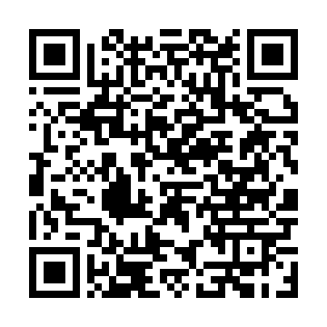

[English](README.md) | **繁體中文** | [日本語](README.ja.md)

# n3ds cast

透過 Google Cast 把 New 3DS（畫面與遊戲音訊）串流到電視，或串流到電腦上的瀏覽器。它擷取主機當下顯示的內容，在主機上編碼成 JPEG，再傳給接收端網頁。

需要**執行 Luma3DS 的 New 3DS / New 2DS XL**。不會對遊戲注入任何東西：沒有 hook，也沒有外掛。

## 安裝與使用

用 FBI 安裝最新版本的 `.cia`：在 FBI 選擇 *Remote Install* > *Scan QR code*，掃描下方的 QR code；也可以把檔案複製到 SD 卡。（`.3dsx` 可改由 Homebrew Launcher 執行。）



<https://github.com/weiking1021/n3ds-cast/releases/latest/download/n3ds-cast.cia>

接著：

1. 啟動應用程式；電視清單會陸續出現（區域網路上的 Cast 裝置，以及有執行的話還有 PC 接收端）。
2. 選擇電視並開始串流，回到 HOME 開啟遊戲。擷取的是*遊戲*，不是這個應用程式。
3. 結束後再次啟動應用程式：它會重新連上執行中的背景處理程序。

啟動 NDS 遊戲會結束串流。

## PC 接收端

瀏覽器分頁可以取代電視：

```
cd receiver
npm install            # 只需一次
npm start              # 開啟 http://localhost:8080
```

先開啟分頁，再於 3DS 的電視清單中選 **PC Receiver (dev)**（或輸入電腦的 IP），然後開始串流。要有聲音，需在分頁中按「啟用聲音」。

## 建置

只需要 Docker：

```
./build.sh                # out/n3ds-cast.cia 與 out/n3ds-cast.3dsx（Windows 用 build.bat）
```

## 第三方

UI 字型：Noto Sans TC Regular，SIL Open Font License 1.1（`3ds/app/assets/OFL.txt`、`COPYRIGHT.txt`）。
